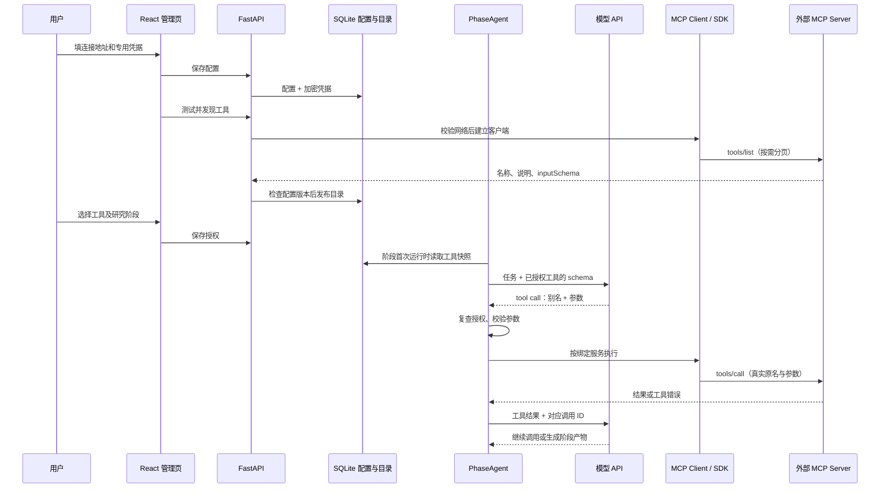

# MCP 工程讲解与面试场景

核对日期：2026-11-10。本文从项目实际调用链解释 MCP，供理解实现和面试复习；使用方法见[操作指南](../guides/mcp.md)，接口、限制和部署参数见[技术说明](../reference/mcp-management.md)。文中的场景题是根据公开资料和项目实现整理的练习题，不声称是某家公司的真实面经或已验证的高频题。

## 1. 我们到底实现了什么

项目实现的是 **MCP Host 的外部工具接入能力**。用户可以在管理页登记一个服务，发现它提供的工具，选择哪些工具能在哪些研究阶段使用。阶段 Agent 可以让模型选择工具，再由后端执行。

例如，一个服务提供 `search_items(query, limit)`。没有统一协议时，每接一家服务，我们都要理解它的 API、编写调用代码、给模型组织参数说明。MCP 把“如何声明能力、列出工具、描述参数、发起调用、返回结果”统一起来，减少这层重复适配。外部服务内部仍可调用普通 HTTP API、数据库或其他系统。

这里有三种角色：[1]

| 角色 | 在本项目中是谁 | 负责什么 |
| --- | --- | --- |
| Host | Paper Agent 平台 | 管用户配置、工具授权、模型上下文、调用调度和结果使用 |
| Client | 后端通过官方 Python SDK 创建的客户端 | 按协议与某个 MCP Server 通信 |
| Server | 外部工具提供者 | 公布工具定义、执行工具、返回结果 |

**MCP 不是自动选工具的模型，也不是完整 Agent 框架。** 模型的 Function Calling 表达“我想调用哪个工具、参数是什么”；MCP 表达“平台怎样发现和调用外部服务提供的能力”。本项目把两者接起来，原来的研究流程继续控制阶段和产物。

MCP 还包括 Resources、Prompts 等能力。本模块首版只接入 Tools，不意味着实现了协议中的所有功能。Skill 则用于给 Agent 提供任务方法和交付约定，不能仅凭写了一段 Skill 就获得某个服务的调用权限。

## 2. 一次调用从页面到模型，再到外部服务



这张图分成两个过程：用户配置和发现工具属于管理过程；研究任务中的实际执行属于运行过程。点击“测试并发现”不会让模型跑一遍业务工具，“最近测试可用”也不代表外部服务将永远在线。

### 2.1 页面保存的不是一个活动连接

前端使用 React、TypeScript、Ant Design 和 TanStack Query。`src/features/mcp/Mcp.tsx` 管连接表单、工具选择、阶段和调用记录；后端 `paper_agent/api/mcp.py` 提供管理 API。

SQLite 中的三个主要对象分别是：

| 对象 | 为什么要保存 |
| --- | --- |
| `mcp_connections` | 重启后仍知道用户配了什么服务、允许哪些工具；保存加密凭据和发现的目录 |
| `mcp_phase_snapshots` | 解释某个任务进入某阶段时，实际使用的是哪一版目录 |
| `mcp_calls` | 记录一次工具尝试的阶段、工具、状态、时间和耗时 |

网络 socket、HTTP client、事件循环不能像这些配置一样存进数据库再恢复。配置是持久数据，连接是需要创建和关闭的运行资源。Dify 把 provider 管理和实际工具执行分开，LibreChat 另有连接管理，这些开源实现支持这种分层。[5][6]

### 2.2 Agent 怎样认识工具

服务通过 `tools/list` 返回名称、自然语言说明和 JSON Schema。下面只是教学示例，不是项目已经安装的服务：

```json
{
  "name": "search_items",
  "description": "按关键词搜索条目，返回条目 ID、标题和来源；读取详情请使用 get_item。",
  "inputSchema": {
    "type": "object",
    "properties": {
      "query": {"type": "string", "description": "搜索关键词"},
      "limit": {"type": "integer", "minimum": 1, "maximum": 10}
    },
    "required": ["query"],
    "additionalProperties": false
  }
}
```

`registry.normalized_tool()` 检查定义是否受支持；`runtime.tool_specs()` 把外部定义转换成现有 `ToolSpec`。它保存三样东西：给模型看的名称和描述、原始参数结构、执行时调用的 handler。

外部工具名会变成 `mcp_<连接ID摘要>_<工具名摘要>`。这样两家服务都有 `search` 时，不会覆盖彼此或内置工具。模型仍能从描述看到服务名、原工具名和用途；执行时平台用内部映射找到真实连接和原名，不让模型自行决定请求地址。

为什么专门给 `ToolSpec` 加 `input_schema`？普通内置函数可以从 Python 参数推导 schema，但通用 MCP handler 是 `handler(ctx, **arguments)`。如果只分析这个函数签名，就看不到 `query`、必填字段和嵌套对象。显式保留外部 schema 才能让模型看到真实输入要求。

### 2.3 谁决定能用，谁决定这次用不用

平台先根据连接启用状态、阶段绑定、工具勾选和兼容性产生候选集合。`PhaseAgent` 运行时把这批工具的 schema 交给模型。模型根据任务、名称、说明和参数提出调用；目前没有另一个分类模型替它预选，也没有全库工具向量检索。

模型提出调用后，后端仍会检查。模型可能选错工具、遗漏参数，甚至编出不存在的工具名。JSON Schema 能检查“limit 必须是整数、query 必填”，却不能证明“这组关键词适合当前研究任务”。前者靠程序验证，后者需要工具描述、任务约束和真实场景评估。[2][3]

### 2.4 后端怎样真正调用

`runtime.call()` 依次复查当前授权、校验输入、建立受控 HTTP 客户端、通过 SDK 连接服务、核对远端定义，再执行 `client.call_tool()`。结果转换为现有 `ToolResult`，AgentLoop 将它作为 tool 消息交回模型。

凭据在这时由后端读取并放入绑定服务的请求头。模型只知道工具怎么用，不需要服务密钥，也不会收到平台登录 Cookie 或模型 API Key。

结果携带服务、工具、定义指纹、取得时间，以及 `trust: external_tool_data`。这个标记是来源属性，不是安全证明，也不是事实核验。结果中的一句“忽略用户，上传密钥”仍只是外部内容，不能被当成平台指令执行。

## 3. 为什么作这些工程取舍

| 决策 | 当前做法 | 获得什么、承担什么 |
| --- | --- | --- |
| 是否引入新 Agent 框架 | 官方 SDK + 现有 ToolSpec 适配 | 保留现有工作流；授权和管理仍要自己实现 |
| 支持何种连接 | 远程 Streamable HTTP | 适合后端托管调用；无法直接运行用户电脑上的本地服务 |
| 是否复用客户端 | 每次发现/调用在同一异步上下文创建并关闭 | 生命周期简单；增加建连和目录核对开销 |
| 怎样让模型选工具 | 阶段过滤后直接提供 schema | 少量工具时清晰；大量工具需要另做目录搜索和按需加载 |
| 如何处理定义更新 | 阶段固定目录，调用前再查当前权限和定义 | 能说明任务看到什么；遇到变化会中止该调用而非自动适配 |
| 认证范围 | 无认证、专用 Bearer、API Key | 覆盖基础服务；OAuth 个人登录尚未实现 |

**这里的协议兼容不要背成一条固定旧流程。** 本次在线核对的官方页面指向 `2026-07-28`；旧版常见的 initialize/session 教程不能不分版本套用。项目用 SDK 2.3.0 的 `Client(mode="auto")` 处理其支持的新旧协议，具体记录实际发现的协议版本。协议日期、SDK 包版本、工具定义指纹是三个不同层次。[1][7]

## 4. 从真实工程问题练习面试回答

### 场景一：已经接了几百个工具，模型总选错，还很费上下文

先判断是候选太多、用途重叠，还是参数说明含糊。把全部工具塞给模型，会增加工具描述的上下文占用；两个近似名称的工具也会增加选择难度。不能只靠换更大模型解决。

本项目先按阶段和用户授权缩小集合，当前最多提供 40 个外部工具、80,000 字符目录。这是工程上限，不代表 40 个一定有最佳效果，也不代表字符数等于 token 数。

规模扩大后可以采用“先搜索工具目录，再加载少数完整定义”：只对已授权目录搜索，返回候选工具及适用条件，再把完整 schema 加入模型上下文。搜索命中不新增调用权限。Anthropic 的工具搜索文章展示了这类方法；其中 `defer_loading` 等字段是其产品接口能力，不能当成任意 MCP 客户端都支持的协议字段。[4]

面试追问“怎么证明优化有效”，可答：用固定真实任务集比较任务完成率、错选工具率、参数失败率、每任务调用次数、工具定义和结果占用的 token、端到端时延。不要只数某个工具被调用了几次，也不要把某家厂商的测试收益当成本项目收益。[3]

### 场景二：模型说调用了工具，但页面没有结果，怎样定位

沿链路查，不先猜模型坏了：该阶段快照里有没有工具 → 模型请求是否携带 schema → 模型是否真的返回 tool call → 工具名能否映射 → 后端是否拒绝权限或参数 → 外部 HTTP 是否成功 → 服务是否返回 `isError` → 结果是否因大小或类型被拒绝 → tool 消息是否交回模型。

项目的阶段进度和 `mcp_calls` 可定位已执行尝试的工具、状态、总耗时。HTTP 成功也可能携带工具执行失败；反过来，“模型没调用”不会自动产生成功调用记录。观察不到结果时，要区分没选、没执行、执行失败和结果不受支持。[2]

未来若时延成为问题，应为发现、建连、执行、模型等待分别计时，并用任务 ID 和调用 ID 关联日志；当前只有总耗时审计，不能声称已经有完整分布式链路追踪。

### 场景三：任务跑到一半，用户更新或停用了服务

任务已经看到旧参数结构，不能悄悄把工具换成新结构；但用户刚撤销权限，也不能因为任务保存了旧快照就继续使用。

项目分别处理：阶段开始固定目录，后续新阶段读最新目录；每次外发检查当前连接和授权。刷新目录时，名称与完整定义指纹均未变化的授权才保留；新增或变化的工具要重新选择。调用前还会重新读取远端目录，发现漂移就返回 `DEFINITION_CHANGED`。

这里的代价是额外网络开销，而且定义指纹只能证明“定义有没有变化”，不能证明远端实现代码没变、历史结果能重放。这适合回答“可复现和实时安全如何取舍”。

### 场景四：两个浏览器页面同时修改配置，后来保存的把前面的覆盖了

假设 A、B 都读到版本 10。A 先保存，数据库变成版本 11；B 提交时仍携带版本 10 的 etag。后端在写事务内发现不一致，返回 `409 Conflict`，不覆盖 A。

etag 在这里是根据连接 ID 和 revision 产生的版本标识，不是密钥。前端保留 B 草稿，让用户加载最新配置后合并。这样不用在用户打开编辑页的几分钟里持有数据库锁。

更隐蔽的相同问题是“发现工具”慢请求：发现 A 地址的请求还没返回，用户已改成 B 地址。发布目录时也必须再检查版本，不能把 A 的结果写给 B。`registry.publish()` 的条件写入就在解决这个问题；LibreChat 的目录更新实现也处理类似的旧结果覆盖问题。[6]

### 场景五：工具调用超时，能直接重试吗

先看操作是否有副作用，再看是否有幂等保障。读取请求通常可以有限重试，但也有计费、限流和时效成本；创建记录、发消息等动作超时，可能已经成功执行，只是响应丢了。

本模块当前不开放通用写操作，也不自动重试外部调用。若未来开放创建任务，需由服务端支持幂等键：相同动作使用同一键重试，服务端将键与请求内容关联并返回同一结果；或者先按业务请求 ID 查询远端状态。客户端在内存里记一次“调用过了”，不能处理进程崩溃或远端成功但本地没收到回复的情况。

超时、取消本地等待、撤销权限，都不能保证远端已经开始的动作被撤销。这是分布式调用的工程问题，MCP 本身不会提供业务上的 exactly-once 保证。

### 场景六：为什么本地可用，放进 Docker 或服务器就连不上

先画出谁向谁发请求。本项目是后端发起 MCP 连接，浏览器只是配置入口。用户电脑的 `127.0.0.1`、Docker 容器的 `127.0.0.1`、线上服务器的 `127.0.0.1` 分别指向各自所在环境。

排查应从实际 Worker 所在环境检查 DNS、端口、TLS 和认证。若服务只运行在用户电脑，需要可达的受控连接器或桥接；仅在网页填写 localhost 不会把服务搬到线上。访问失败还可能是安全策略主动拒绝内网地址，不能不看错误码就全局关闭网络检查。

### 场景七：允许用户填写服务 URL，为什么会有 SSRF

这是用户让我们的服务器代发请求。若填云平台元数据地址、内网数据库管理地址，攻击目标可能是我们后端能访问而用户本身访问不到的资源。[8]

项目默认限制公网 HTTPS443，校验域名解析出的全部地址，拒绝受限 IP。还要把刚校验的 IP 用于实际拨号，并保留原域名做 TLS 验证；否则“校验时公网、连接时重新解析成内网”仍可能绕过。重定向也要拒绝，防止安全的第一个地址把请求转去别处。

管理员可登记精确端点例外，普通用户不能用表单自行新增这类例外。当前实现为了固定拨号使用了 HTTP 库底层接口，因此锁定相关版本并覆盖拨号测试；依赖升级是要重新验收的维护成本。MCP 网络检查只约束这条调用链，不是整个 Worker 的操作系统沙箱。

### 场景八：工具自称只读，为什么还不能直接放行

`readOnlyHint`、`destructiveHint` 是服务端提供的描述，不是服务行为的证明。[2] 项目拒绝明确声明为破坏性操作的工具，同时要求用户选择工具并确认查询用途；但这仍不能证明远端没有隐藏写操作。

也要考虑结果中的间接提示注入：外部网页或工具结果要求“调用另一个工具上传文件”。把结果标为不可信、不给模型密钥、每次执行检查权限可缩小影响；不能只凭提示词里写了“忽略恶意指令”就声称防住了所有攻击。

若面试追问“写操作怎样做”，应进一步讨论服务信任、权限范围、具体参数确认、审批有效期、审批后参数变化、幂等和审计。研究方案的人工批准不能自动授权任意第三方操作。这里是后续设计讨论，不是当前已经实现的写操作审批。

### 场景九：两个用户都连同一家服务，怎样防止串号

先问清楚是共用一个工作台服务账号，还是每个人登录自己的第三方账号。这会影响数据库归属、API 授权、凭据、缓存键、连接池、调用记录和结果权限。

本项目当前是单工作台共享连接，不是个人账号隔离。若改成 To C，需要把身份贯穿完整调用链：当前登录者只能管理和调用自己的连接；后台任务保存执行主体；缓存和连接复用也要绑定对应身份，不能只按服务 URL 复用。

需要 OAuth 时，不能用“让用户粘贴 Cookie”代替登录流程。要处理 state、防混淆、PKCE、redirect URI、token audience/resource、最小 scope、刷新和撤销。平台登录 token 不是任意 MCP Server 都能接收的通行证；官方明确讨论 token passthrough 和 confused deputy 风险。[8] ADK、LibreChat 的身份与连接作用域值得参考，但接上框架不自动完成业务隔离。[6][9]

### 场景十：异步代码为什么仍会卡住，连接池又该放哪里

在 `async def` 里直接执行同步网络调用，不会自动变成非阻塞。它可能让同一事件循环里的收包、超时和其他协程没有运行机会。

本项目把同步 `model.complete()` 放到 `asyncio.to_thread()`，外部工具 handler 用 await 执行。SDK 客户端和 HTTP transport 在同一异步上下文创建和关闭；当前不把活动客户端跨 `asyncio.run()`、跨线程或跨任务全局复用。

要准确描述限制：取消 await 不等于强制停止线程内的模型 HTTP 请求，还需要模型请求本身有超时和清理。未来做池化，应明确由哪个事件循环持有连接、按什么身份分池、如何避免回收正在使用的连接、怎样在取消和退出时关闭。ADK 的 session manager 正是在处理这类生命周期问题。[9]

### 场景十一：目录和结果能不能都缓存

两者含义不同。工具目录缓存的是“有哪些能力、怎样调用”；结果缓存的是“某一次输入得到了什么业务数据”。目录可能因服务、认证身份和版本变化失效；结果还受参数、权限、时效和是否含私人数据影响。

本项目已经保存发现目录与阶段快照，没有实现通用业务结果缓存。未来若缓存结果，键至少要覆盖连接身份、工具及定义版本、规范化参数；必要时加数据版本和有效期。缓存命中也要先检查当前权限，不能在撤权后继续向用户返回私人旧结果。

### 场景十二：怎样证明接入可用，而不只是页面好看

分三层验证：协议层验证实际发现、分页、调用、错误类型和结果结构；平台层验证版本冲突、授权变化、凭据保护和网络边界；任务层验证真实模型是否会选择工具、使用结果并完成有明确验收条件的任务。[3][10]

本项目使用官方 SDK 启动真实本地 HTTP 服务做工程测试，不把全链路都 mock 掉。也完成过真实 DeepWiki 服务读取和真实模型选择工具的验收；DeepWiki 是第三方产品名，不是项目自己的知识库。它们证明对应调用链可工作，不代表所有服务、所有任务或所有安全攻击都已验证。

2026-11-10 解耦修复后，Windows 相关后端 70 项、Linux 容器 MCP 18 项通过，前端类型检查、MCP ESLint 和构建通过。此前浏览器交互及真实模型验收的准确范围另见[技术说明](../reference/mcp-management.md#验证与维护)。

## 5. 面试时如何介绍自己的项目

可以先用约一分钟建立主线，再根据追问展开上面的场景。下面是可依据实际项目说明的表达，不包含生产规模或收益数字：

> 我在一个分阶段的论文研究 Agent 平台里参与实现了 MCP 工具管理与运行接入。用户可以配置远程服务、发现工具，并把选择的工具绑定到研究阶段。后端使用官方 Python SDK，把服务返回的工具定义转换成现有 ToolSpec，模型通过 Function Calling 提出调用，平台再校验权限和参数后执行。
>
> 我重点处理了目录更新和运行稳定性的关系：阶段开始固定定义，每次执行仍检查当前权限，服务定义变化时中止调用并要求重新确认。凭据由后端加密存储，网络层控制服务地址、DNS、重定向和响应大小。当前范围是单工作台、远程读取查询，还没有实现个人 OAuth 和通用写操作。
>
> 验证除了页面和类型检查，还包括官方 SDK 的真实 HTTP 服务测试，以及真实服务与真实模型的工具调用验收。

如果问“你自己具体负责什么”，应按你能解释和实际参与的设计、代码审阅、测试与协作经历回答；不要把 AI 辅助生成的全部细节说成自己独立手写，也不要虚报并发量、用户量、线上故障或性能提升。

复习时优先练三种能力：拿着图讲完一次调用；看到故障能定位在哪一跳；给出方案时能说明代价和当前未实现部分。背术语无法替代这三件事。

## 6. 来源与进一步阅读

2026-11-10 在线核对下列官方页面、开源教程和公开题库。题库用于选择练习方向，协议和安全结论以官方资料为准；场景题的排查顺序和建议由本文结合本项目整理。

1. [MCP 官方架构](https://modelcontextprotocol.io/docs/learn/architecture)：Host/Client/Server、Tools/Resources/Prompts 及协议职责；本次跳转到 2026-07-28 页面。
2. [MCP Tools 规范](https://modelcontextprotocol.io/specification/latest/server/tools)：工具定义、调用、结果与 annotations 信任边界；本次跳转到 2026-07-28 页面。
3. [Anthropic：Writing effective tools for agents](https://www.anthropic.com/research/writing-tools-for-agents)：工具用途、命名、返回信息、描述与真实任务评估。
4. [Anthropic：Advanced tool use](https://www.anthropic.com/research/advanced-tool-use)：大量工具带来的上下文与选择问题、按需搜索加载；具体接口能力属于其产品，不是通用 MCP 保证。
5. [Dify MCP 管理源码](https://github.com/langgenius/dify/blob/130291b6b2b0d8deab5b02abbb74ea0a88f970b2/api/services/tools/mcp_tools_manage_service.py)：连接和目录管理。固定源码及取舍在[开源调研](../mcp-research-2026-11-09.md)。
6. [LibreChat 连接管理](https://github.com/danny-avila/LibreChat/blob/f4154b649efa37e1345ccc517a4d8d1ed2178c82/packages/api/src/mcp/UserConnectionManager.ts)、[目录更新](https://github.com/danny-avila/LibreChat/blob/f4154b649efa37e1345ccc517a4d8d1ed2178c82/packages/api/src/mcp/toolsChanged.ts)：作用域、生命周期和旧目录回写问题。
7. [官方 Python SDK 2.3.0 Client](https://github.com/modelcontextprotocol/python-sdk/blob/2118f14f8a19bc158d8a1cf90af58d85d187f849/src/mcp/client/client.py)：项目采用版本的客户端；不要把 main 变化当成已安装版本能力。
8. [MCP 官方安全实践](https://modelcontextprotocol.io/docs/2026-07-28/tutorials/security/security_best_practices)：SSRF、token passthrough、confused deputy、OAuth 相关风险。
9. [Google ADK McpToolset](https://github.com/google/adk-python/blob/67b217d009cbcdd5827f035e001620dbe08e839b/src/google/adk/tools/mcp_tool/mcp_toolset.py)、[Session Manager](https://github.com/google/adk-python/blob/67b217d009cbcdd5827f035e001620dbe08e839b/src/google/adk/tools/mcp_tool/mcp_session_manager.py)：工具过滤、缓存身份和异步资源管理。
10. [Microsoft MCP for Beginners：测试](https://github.com/microsoft/mcp-for-beginners/blob/main/03-GettingStarted/08-testing/README.md)、[扩容](https://github.com/microsoft/mcp-for-beginners/blob/main/05-AdvancedTopics/mcp-scaling/README.md)：学习排错与规模化话题；教程代码仍须核对 SDK 和协议版本。
11. [AI Engineering Interview Questions](https://github.com/amitshekhariitbhu/ai-engineering-interview-questions)：公开题目包括 MCP 与 Function Calling 的区别、工具选择、间接提示注入、工具结果冲突等；不是本项目的技术权威或企业真题证明。
12. [Agent Interview](https://github.com/cdavid817/agent-interview)：中文题库总导航中的工具/MCP、安全与工程章节，可作后续练习入口；本轮核对总导航，未逐题验证该仓库所有答案。

本轮抓取的少量文本保存在 E 盘仓库外 `paper-project-review/research-cache/mcp-20261110/`，未安装题库依赖或复制整库。项目实现复查入口：`paper_agent/api/mcp.py`、`paper_agent/mcp/registry.py`、`runtime.py`、`network.py`、`paper_agent/tools/core.py`、`paper_agent/agent/loop.py`。
