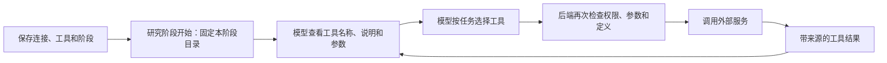

# MCP 工具使用说明

MCP 让研究 Agent 调用外部服务提供的工具，例如查询论文候选、读取公开代码库文档。它不替代 Skill：Skill 说明研究方法与交付要求，MCP 提供可实际执行的外部能力。

## 添加一个连接

1. 点击侧边栏 **MCP 工具**，再点 **添加服务**。
2. 填写名称、完整 Streamable HTTP 地址和认证方式。公网地址使用 HTTPS 443；地址里不能带账号、密钥查询串或片段。不是任意网页都能作为 MCP 地址。
3. 需要认证时，填写该服务专用的 Bearer Token 或 API Key；API Key 可以指定请求头名称。已有密钥不会回显，留空并选择“保留当前密钥”即可继续使用；清除密钥需要明确选择。
4. 点击 **保存配置**，再点 **测试并发现工具**。页面显示等待提示；通常几秒，整体发现限时约 45 秒。失败会显示原因，保留已有配置和目录，不显示虚假的百分比。
5. 在 **工具与阶段** 中选择工具、适用研究阶段，核对仅用于读取或查询，再保存。只添加连接或发现目录，不会自动授权所有工具。

例如，公开文档服务的地址可以是 `https://mcp.deepwiki.com/mcp`，无须认证。可以只选择 `read_wiki_structure` 并绑定文献研究，先读取代码库目录。DeepWiki 是第三方公共服务，与本项目的 Wiki 知识库无关；这只是接入示例。若本机代理把域名解析到 `198.18.*` 等受限地址，联系管理员核对网络后登记精确端点，不能关闭整个网络检查。

页面上的“最近测试可用”表示最近一次发现成功，不代表保持着长连接。服务的实时可用性以实际调用为准。

## Agent 什么时候使用

当前配置在整个工作台共享，未做按用户或按项目的私有隔离。它适合现有单工作台模式。没有绑定阶段的连接不会提供给 Agent；绑定也不表示模型每次必定调用。

阶段已经开始时，修改工具列表不会直接插入当前阶段。尚未开始的下一阶段会读取最新配置。停用、删除连接或取消工具授权会在下一次外发请求前检查并阻止调用；已经发送的请求不能撤回。

MCP 按绑定阶段独立提供工具，不依赖 Wiki 是否配置、是否已有取证结果。每阶段 MCP 最多尝试 6 次调用，与 Wiki 自己的检索预算分开；交付 Wiki 依据包不会关闭已授权的 MCP 工具。工具结果返回当前阶段 Agent，由它按任务使用，不自动写入 Wiki。方案统一修订保持现有无工具约定，不因接入 MCP 自动获得权限；专家批准也不被绕过。

## 更新工具、查看记录

服务升级后，点击 **测试并发现工具**。名称和定义完全相同的工具继续保留授权；新增或定义变化的工具需要重新选择。修改地址、认证方式、API Key 请求头或密钥后，旧目录清空，须重新发现并授权。

进入连接的 **调用记录**，可看到最近 50 次调用的工具、阶段、状态、耗时和时间。通用调用表不保存参数和结果正文；原有 Agent 会话和阶段进度仍可能保存实际使用的材料，应按研究数据管理。

## 保存冲突和常见问题

如果两个页面同时编辑，先保存者成功，后保存者会提示配置已变化，并保留当前草稿。不要一直点保存；先复制要保留的修改，再点击 **加载最新**，在新配置上合并。未保存关闭或离开会提示确认，浏览器本地存储不保存密钥。

| 提示 | 处理方式 |
| --- | --- |
| 未配置凭据加密密钥 | 管理员配置主密钥文件并重启后端，之后才能保存服务密钥。无认证服务不受影响。 |
| AUTH_REQUIRED | 核对服务密钥及权限；需要 OAuth 登录的服务本版尚不支持。 |
| NETWORK_DENIED / DNS_FAILED | 检查最终端点与后端所在网络；内网例外只能由管理员登记。 |
| REDIRECT_DENIED | 核实最终 MCP 地址，不把凭据跟随重定向发往其他地址。 |
| DEFINITION_CHANGED / REVOKED | 重新发现并核对工具，重新选择后从新阶段使用。 |
| RESULT_TOO_LARGE | 缩小查询或读取范围；系统不会静默截断后声称完整成功。 |
| UNSUPPORTED_CONTENT | 首版只支持文本和结构化 JSON；图片、音频和资源结果需要后续适配。 |
| BUDGET_EXHAUSTED / TIMEOUT | 按现有材料交付缺口，或人工调整任务；系统不自动重试外部调用。 |

首版不支持任意 `npx`/`uvx`/shell 服务启动命令、OAuth、外部写操作、个人电脑文件连接器，也没有把本地 Wiki 发布成公共 MCP Server。服务自称只读并不证明它可靠，选择工具时仍需了解实际用途。

管理员部署步骤和安全边界见 [技术说明](../reference/mcp-management.md)。
