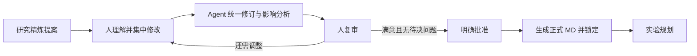

# 方案审阅使用说明

这个模块位于**研究精炼完成之后、实验规划开始之前**，目的是让人先理解并决定要做什么，再让 Agent 安排实验。专家模式需要明确批准，自动模式保持原有工作流。

## 一轮完整操作

1. 打开项目中的方案审阅入口，先读方案总览和重点部分；方法画布展示同一方案的方法关系，完整正文按需展开。
2. 要修改时，选择正文中的文字并加入修改意见，也可以直接添加意见或编辑对应部分。相关部分可定位，阅读后可返回原先位置。意见要先加入本轮，再统一提交。
3. 方法关系有变化时，进入方法画布。可修改节点内容、增删节点及连接；删除节点不会替你推断并重连剩余方法。节点编辑先应用到草稿，再保存。
4. 点击 **提交 Agent 修订**，集中提交本轮修改。系统会显示准备、等待模型、接收内容、校验和保存等状态；接收字符数表示响应在到达，不是完成百分比。也可在运行动态查看任务。
5. Agent 返回完整统一方案、直接修改及关联影响。优先复审变化和待决问题，其余细节按需阅读。仍不满意就继续修改，再提交一轮。
6. 有待决问题时，点击 **查看待决问题** 定位，填写你的决定后再次提交修订。当前所有待决问题都需要解决，不能直接越过批准。
7. 满意且通过批准条件后，点击 **批准并进入实验规划**。程序从这一版完整正文生成正式 MD、保存锁定副本，再交给原有实验规划流程。

## 保存、修订、批准是三个动作

| 动作 | 发生的事情 |
| --- | --- |
| 保存草稿/画布 | 保存你的输入，保留原提案，不会开始实验。 |
| 提交 Agent 修订 | 调用模型分析修改和影响，生成统一候选，仍回到人复审。需要后端模型配置可用。 |
| 批准并进入实验规划 | 核验当前候选、版本和检查点，生成正式 MD，然后推进流程。下游模型调用需要独立具备可用配置。 |

批准时不会再让模型改写一遍正文。这样可以保证人确认的内容与交给实验规划的内容一致。历史批准版本保留；后续草稿修改不会偷偷改写已经交付的版本。

## 为什么下一步不可点

- 存在待决问题：用定位按钮找到问题，给出决定并重新提交修订。
- 人工修改尚未统一修订，或还有未加入的意见：先完成本轮意见，再提交 Agent。
- 正在执行其他任务：等待完成，或在运行动态停止后处理。
- 原提案或其他页面已改变：先保留本地草稿，再加载和核对最新版本。
- 当前不是专家模式的研究精炼检查点：历史方案可查看和保存草稿，但不能从这里批准当前工作流。

修订失败时看具体错误和运行记录。未完整接收或校验失败的候选不会覆盖草稿；不要把“已经收到一些字”理解成“方案已修好”。

相关：[Skill 管理](skills.md) · [方案审阅技术说明](../reference/proposal-review.md)
