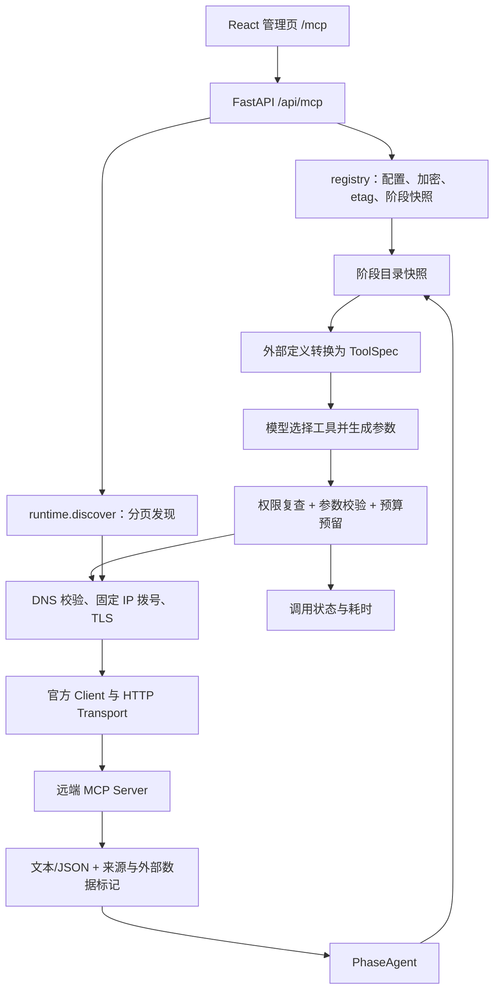

# MCP 管理与 Agent 调用技术说明

本模块实现 **MCP Host**：现有 Paper Agent 作为客户端，调用外部 MCP Server。保留原有 `AgentLoop`、`PhaseAgent`、`ToolSpec` 和阶段编排，协议交给官方 Python SDK `mcp==2.3.0`；没有引入另一个 Agent 框架或网关。原有图像 MCP 桥保持独立。

## 模块与调用链



| 文件 | 职责 |
| --- | --- |
| `paper_agent/api/mcp.py` | 管理 API、输入验证、错误边界；验证错误不回显包含密钥的输入。 |
| `paper_agent/mcp/registry.py` | SQLite 配置与工具目录、Fernet 凭据、etag、阶段快照、审计与预算预留。 |
| `paper_agent/mcp/network.py` | 端点规范化、DNS 检查、IP 固定拨号、禁止重定向与环境代理、响应限额。 |
| `paper_agent/mcp/runtime.py` | SDK 生命周期、完整分页、ToolSpec 转换、逐次授权及结果转换。 |
| `paper_agent/agent/loop.py` | 阶段加载工具，模型调用在工作线程执行，工具继续支持异步 handler。 |
| `paper_agent/api/worker.py` | 绑定 run ContextVar，使阶段快照和调用预算跟随任务。 |

SDK `Client(mode="auto")` 处理当前协议探测及旧版 initialize/session 兼容；不手写一套 JSON-RPC 初始化。每次发现或工具调用创建独立异步客户端，在同一事件循环内用上下文管理器关闭。首版不做常驻连接池，减少跨线程、跨事件循环和凭据更新带来的失效状态；代价是逐次连接和重新核对目录的开销。

## 数据、版本与并发

数据在 `PAPER_AGENT_WEB_DATA/management.sqlite3`，与现有工作台数据共存，新增表使用 `CREATE TABLE IF NOT EXISTS`，不改研究文档或线上数据库。

| 表 | 保存内容 |
| --- | --- |
| `mcp_connections` | 名称、端点、阶段绑定、工具授权、加密凭据、目录、协议、发现时间、状态、递增 revision。 |
| `mcp_phase_snapshots` | `(run_id, phase)` 对应的目录快照；包括端点、工具定义与指纹，不包括凭据。 |
| `mcp_calls` | 连接、任务、阶段、工作区、工具、状态、耗时、时间；不存参数和结果正文。 |

每次配置保存或目录发布增加 revision，`etag=SHA256([id,revision])`。更新、删除、发现发布均携带读取时的 expected_etag，在 SQLite `BEGIN IMMEDIATE` 内检查；过期返回 409，不覆盖另一个页面的新内容。比如 A、B 同时读到 v1，A 保存到 v2，B 再用 v1 的 etag 提交就被拒绝。前端保留 B 的草稿，让人加载最新后合并。

发现可能耗时，网络请求不持有数据库写锁。发现完成再检查 etag，避免旧请求把新地址的目录覆盖掉。发现失败只更新对应 revision 的状态，保留已有目录。

工具定义使用服务返回的完整定义 JSON 指纹，覆盖参数、说明、annotations 等。重新发现只保留名称和指纹都相同的已有授权。变更新增不自动授权。地址或认证身份变化则清空目录和授权，重新发现后再选。

任务在首次进入一个阶段时固定该阶段目录，下一阶段首次进入时读取最新配置；重试当前阶段继续沿用快照。同一 Worker 的后续阶段不再被任务启动时的旧目录锁死。API 任务的快照持久化，CLI 无 run_id 时由 PhaseAgent 实例保留。快照冻结的是目录；凭据不复制进去。

**冻结目录不冻结权限。** 每次外发请求重新读取当前配置，检查连接启用、阶段绑定、工具仍被授权、定义指纹、端点和认证方式。删除或停用立即影响后续请求，已发送请求无法撤回。每次实际调用还重新读取远端目录并核对定义，发现漂移时返回 DEFINITION_CHANGED，不静默使用新参数执行。

## 模型如何认识、选择工具

服务器的工具名、description 和 inputSchema 被转换为现有 `ToolSpec`。模型看到的别名是连接 id 与工具名摘要组成的 `mcp_...`，避免不同服务同名冲突；界面和来源保留原工具名。`tool_schema` 直接保留服务器 JSON Schema，而不是通过 Python handler 的 `**arguments` 猜参数。

模型根据研究任务和描述选择工具、生成参数；没有独立分类模型或新的检索路由。平台提前用阶段、工具勾选和兼容性过滤缩小范围，当前每阶段合计最多 40 个外部工具、80,000 字符目录。目录较多时应先减少授权；尚未做工具目录搜索或延迟加载。

调用参数先经 Draft 2020-12 JSON Schema 验证。首版只接受根为 object、最多 16 KB、嵌套深度 16 的参数结构，拒绝引用、正则和映射请求头等暂未适配结构。明确声明 destructiveHint 的工具不可选择；annotations 只用于辅助筛选，不被当成权限证明。查询用途需要操作者核对，本版没有通用写操作审批协议，不能称为代码级证明所有远端操作只读。

SDK 未提供模型 sampling、文件 roots、用户 elicitation 回调，禁止服务把请求转为新的模型调用或用户输入循环。工具返回的描述、文本和 JSON 都是不可信资料，不能改变平台权限；提示词提醒不能代替宿主隔离。

## 调用预算与结果

每个工具适配集合最多尝试 6 次；API 任务还在数据库事务中为 `(run_id,phase)` 原子预留调用记录，防止并发请求同时突破 6 次。预留后记录 running，结束更新具体状态，进程崩溃可能留下 running，可结合任务状态诊断，不自动重放。

MCP 工具在 PhaseAgent 开始运行时按阶段快照加载，与 Wiki 是否存在及是否交付依据包无关。Wiki 取证入口只加载自己的内置工具，不加载 MCP，也不计入 MCP 预算；MCP 调用不消耗 Wiki 检索预算。两者可以在同一研究阶段服务不同任务，没有强制的先后关系或自动入库链路。

文本和结构化 JSON 返回带连接、服务器、原工具名、定义 SHA256、UTC 取得时间及 `trust: external_tool_data` 标记。它表示外部工具数据，不代表内容已被平台验证；研究证据要求属于使用结果的业务流程。纯文本块里包含 JSON 也是合法结果，不强行解析成已验证元数据。多模态或资源内容明确拒绝，不忽略后显示完整成功；远端 isError 会作为工具错误保留。

通用审计表不保存查询正文；原有 Agent 会话或阶段进度仍可能记录参数和正文，因此这不是“所有日志不含研究资料”的保证。

## 网络与凭据

默认只允许公网 HTTPS 443。拒绝含账号、查询串、片段、控制字符的地址；DNS 的全部 A/AAAA 地址必须为公网。连接时只拨刚刚校验的字面 IP，TLS 仍验证原主机名，避免“检查一次公网、实际连接重新解析到内网”的 DNS rebinding。所有请求固定原端点，禁止重定向，不继承 HTTP_PROXY 等环境代理，不做自动网络重试。

`httpx2` 尚未公开网络 backend 注入点，因此当前适配覆盖其底层连接池并使用 `httpcore2` backend；相关版本固定为 2.16.0。依赖升级必须重跑 IP 固定拨号、HTTP 调用和 TLS 验收，不能只改版本号。

管理员可用 `PAPER_AGENT_MCP_TRUSTED_ENDPOINTS` JSON 数组登记**精确完整端点**，允许经核对的内网/非标准端口或 fake-IP 代理环境。这会信任该端点当前解析的地址，不是普通用户可编辑的连接字段；不支持通配符。它不能防止被信任服务主动泄露数据。本地验收已为 DeepWiki 登记该例外；普通新服务仍按默认策略检查。部署环境应单独核对，不在代码中放全局域名白名单。

凭据使用 Fernet 加密，主密钥通过 `PAPER_AGENT_MCP_CREDENTIAL_KEY_FILE` 或环境变量 `PAPER_AGENT_MCP_CREDENTIAL_KEY` 提供。密文存在 SQLite，明文只用于绑定服务的请求头；不向模型提供密钥、不返回给浏览器、不传平台 Cookie 或模型 API Key。认证错误与 SDK 异常统一转为简短错误，不返回 headers 和原始异常体。服务若主动把敏感内容写进普通结果，仍属于不可信外部数据，不能因此宣称结果必然不含敏感信息。

主密钥文件与数据库分开备份，不提交 Git、不随普通数据库导出分发；丢失主密钥会无法解密旧凭据，需要重新填写。恢复或轮换不能只替换随机主密钥，应先设计重新加密/重填流程。当前没有密钥轮换管理界面。

| 限制 | 当前值 |
| --- | --- |
| 发现目录 | 最多 20 页、200 工具、512,000 字符；重复游标/名称拒绝发布。 |
| 发现/调用整体超时 | 45 / 40 秒；连接超时 8 秒，SDK 读取超时 30 秒。 |
| 单个 HTTP 响应 | 2 MiB；要求 identity 编码，拒绝压缩响应。 |
| 提供给 Agent 的完整单次结果 | 30,000 字符；超限报错，不静默截断。 |
| 最近调用展示 | 每个连接最近 50 条；数据库尚未自动清理旧记录。 |

本系统当前是单拥有者工作台，管理接口复用既有登录边界，没有多租户、用户私有连接、项目级 ACL 或 OAuth。已有阶段的 bash 能力仍属于整个 Worker 的权限，MCP 网络限制不是对整个进程的沙箱。面向不可信用户部署还需收紧整个 Worker 的网络、文件和命令权限。

## 部署与运行

常规 Python 安装按 `pip install -e '.[web]'` 安装依赖；主密钥文件由部署环境提供。已有本地 Docker 开发环境可执行：

```bash
docker exec -w /review/paper_agent paper-agent-review-20261029 bash scripts/setup_mcp.sh
```

脚本把依赖装到 E 盘挂载目录 `.paper-agent/mcp-runtime/packages`，主密钥在相邻的 `mcp-credentials/credential.key`，不输出值。`runtime.env` 只存包路径和主密钥文件路径；`start-local.ps1` 读取它，与现有 MinerU/E5 配置一同传给新启动的 API。对已运行 API 需要先正常停止并重新启动；仅编辑环境文件不会让进程重新加载。

Linux 权限使用目录 0700、文件 0600；Windows 挂载盘的实际权限还受宿主 ACL 管理。包和主密钥都在 Git 忽略的 `.paper-agent/` 下，不复制到研究项目。

原有图像桥、方案修订和人工批准规则保持各自契约。暂停配置不删除旧阶段产物，删除连接也不删除历史审计。

## 验证与维护

后端 `tests/test_mcp_management.py` 使用官方 SDK 启动真实本地 Streamable HTTP 服务，验证发现、调用、旧版初始化兼容、参数、结果和权限边界。独立性回归覆盖无 Wiki、有 Wiki、Wiki 依据包已交接时的实际 MCP 调用，并验证 Wiki 取证不加载或执行 MCP。它是协议/工程测试，不是论文研究质量评测。

前端 `playwright.mcp.config.ts` 启动独立测试 API 和官方 SDK 服务。测试先核对 `/api/mcp-test` 标记，仅对隔离数据做创建、授权、冲突和密钥检查。可复用本机 Chrome，不下载浏览器；结果写仓库兄弟目录 E 盘。命令示例：

```bash
python -m pytest tests/test_mcp_management.py
# 前端目录
npx playwright test --config playwright.mcp.config.ts
```

真实外网验收读取 DeepWiki 的 `google-research/timesfm` 目录；随后真实 `gpt-6.1-sol` 通过 PhaseAgent 在两轮模型请求中选择工具、取得结果并生成中文研究便笺。它验证工具接线与来源标记，不证明 TimesFM 适合无历史电芯寿命预测，也未完成新的论文入库或实验。

调研依据、候选平台与后续 OAuth、工具目录按需加载等方向见 [调研记录](../mcp-research-2026-11-09.md)。新增 API 字段同步前端类型；变更网络策略或 SDK 版本时重跑实际 HTTP 与拒绝路径测试。


2026-11-10 验证记录：Windows 相关后端 69 项，实际 Linux 容器 MCP 17 项，桌面/手机浏览器 2 项通过；TypeScript、改动文件 ESLint 和 Vite 构建通过。真实服务/真实模型结果保留在不提交 Git 的本地验收目录；线上服务未部署本次改动。

同日解耦修复验证：Windows 相关后端 70 项、实际 Linux 容器 MCP 18 项通过，覆盖无 Wiki 及 Wiki 交接后的真实本地 HTTP 工具调用；TypeScript、MCP 前端 ESLint 和 Vite 构建通过。本地 API 重启加载修复，继续使用服务器数据的本地开发快照；此前真实外部服务与真实模型的验收记录保留，不计作本轮重测。
