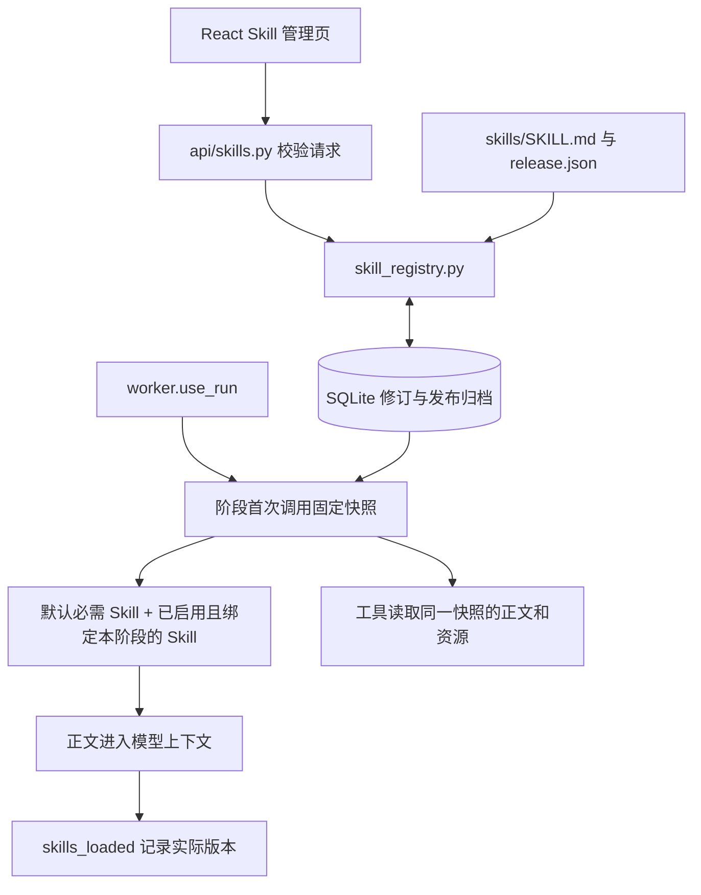

# Skill 管理技术说明

适用：当前 `codex/idea-review` 分支。用户操作见 [使用说明](../guides/skills.md)。这里记录数据契约、运行路径及取舍，便于后续开发和排错。

## 组件与调用路径

前端使用 React 19、TypeScript、Ant Design 5 和 TanStack Query；后端是 FastAPI、Pydantic、SQLite。内置 Skill 正文及资源在 Git 中，工作台定制和运行快照在 `PAPER_AGENT_WEB_DATA/management.sqlite3` 中；未设置变量时位于 `.paper-agent/web/`。

`agent/loop.py:PhaseAgent._skill_prompt()` 调用 `snapshot_for_phase()`、`phase_skills()` 和 `render_context()`。`SKILL_BY_PHASE` 是确定的默认映射，`PHASES` 是管理页可绑定的阶段。并非让模型在整个库中凭相似度选 Skill；名称和用途主要帮助人管理。绑定正文全文注入，配套资源由工具按需读取。

`api/proposal_revision.py` 使用独立的 `proposal_revision` 阶段，只附加显式绑定的 Skill；没有默认独立内置包。其固定 `SYSTEM` 协议仍在代码中，单次请求不提供工具，不自行批准或执行实验。修改研究精炼 Skill 不会自动改变这段修订协议。

## 数据与版本

| 表/字段 | 职责 |
| --- | --- |
| `skill_library(id, head, deleted)` | 当前修订指针；自建项软删除，不抹去历史。 |
| `skill_revisions(skill_id, version, document, created_at)` | 每次保存追加一份不可变个人修订。恢复历史也追加，不倒退指针。 |
| `skill_builtin_releases(skill_id, release_id, document)` | 归档工作台见过的内置发布及资源正文。 |
| `skill_run_snapshots(run_id, snapshot)` | 新运行记录 `phase_start` 策略；兼容旧整任务快照。 |
| `skill_phase_snapshots(run_id, phase, snapshot)` | 该运行、该阶段首次调用时固定的配置和资源。 |
| `builtin_release` | 当前代码的内置发布：`version`、`digest`、`id=version:digest`。 |
| `base_release` | 个人定制所基于的内置发布；旧数据可能未知。 |
| `content_hash` | 当前指令正文的 SHA256；不能代替包含资源的发布指纹。 |
| `etag` | 当前返回状态的指纹，用于防止旧页面覆盖新修改。 |

内置发布号在 [`skills/release.json`](../../paper_agent/skills/release.json)。每个 Skill 的发布指纹包含其元数据、正文以及该 Skill 目录下 `references/`、`templates/` 的文本资源。即使开发者漏改发布号，也能识别内容变化；这只是兜底，发布仍应递增版本号。

例如定制 `v3` 基于内置 `1.0.0:aaa`，仓库升级到 `1.1.0:bbb`：当前定制继续使用 `v3` 与 `aaa` 的配套资源，并提示新发布可查看。恢复最新内置版追加 `v4`，标记 `follows_builtin=true`，之后跟随发布。恢复旧定制则重新采用其旧基准。不会自动把新旧规则做语义合并。

这里的资源固定仅覆盖单个 Skill 包内的可读资源。共享资料库、外部数据、环境依赖与任意脚本不在此快照保证内。发布归档只涵盖工作台实际读取过的版本，不能据此恢复任意历史 Git 提交。

## 保存冲突为什么返回 409

假设 A、B 都读到 `etag=e1`。A 带 `e1` 保存，后端在 `BEGIN IMMEDIATE` 事务中检查当前状态后追加 `v2`，新状态变为 `e2`。B 再带 `e1` 保存时，检查不相等，返回 `409 Conflict`，事务回滚，不覆盖 A。

这是乐观并发控制：用户编辑时不长期锁数据库，只在提交时检查读到的状态是否仍然有效。SQLite 写事务把“检查和追加”放在一起，避免两个保存同时通过旧版本检查。内置包升级也会改变相关状态，旧页面应重新核对。

前端保留编辑中的草稿，提供下载与加载最新；加载最新后同步更新详情缓存和编辑基线。当前不实现自动三方合并。数据库使用 WAL 和 20 秒连接超时，适合当前共享工作台；不据此宣称具备多租户或高并发集群能力。

## 更新何时进入任务

`create_run()` 在创建运行的事务中登记策略，`worker.execute()` 用 `use_run(run_id)` 传播运行上下文。首次进入阶段时，`snapshot_for_phase()` 在事务中检查是否已有 `(run_id, phase)` 快照：有则复用，无则捕获当前配置并保存。`PhaseAgent` 另按阶段缓存，工具上下文拿同一快照。

这样既允许未开始的后续阶段采用新修改，又避免同一阶段多轮调用中途换规则。同一 run 的重试复用已有快照，新 run 重新按阶段捕获。升级前已有整任务快照的运行保持旧策略；没有登记快照的兼容路径会读取当前配置。不能把所有历史执行都描述为已经固定过。

当前每次阶段捕获保存的是完整目录快照，再筛选需要注入的 Skill；因此阶段较多或资源较大时会重复占用数据库空间。当前库规模较小，先选择可追溯的直接实现；若规模增长，应先量测数据库体积，再考虑按内容指纹复用资源。

`skills_loaded` 事件包含实际注入的名称、个人版本、发布基准及正文 hash。该事件表示上下文已准备，不保证模型调用成功、工具执行成功或研究结论有效。

## API 契约

统一前缀 `/api/skills`，沿用现有登录边界。文档请求字段为 `title`、`description`、`instructions`、`enabled`、`phases`；未知字段拒绝。

| 方法与路径 | 行为 |
| --- | --- |
| `GET /api/skills` | 返回 `items`、阶段字典、`scope=workbench`、`activation=next_phase_start`；列表省略正文。 |
| `POST /api/skills` | 创建，返回完整项，状态码 201。 |
| `GET /api/skills/{id}` | 返回完整正文、版本与状态。 |
| `PUT /api/skills/{id}` | 完整文档加 `expected_etag`，追加修订。 |
| `GET /api/skills/{id}/history` | `items` 为个人历史；内置项还附当前内置候选 `version=0`。 |
| `GET /api/skills/{id}/releases` | `items` 为已归档内置发布，含 `resource_paths`，不返回资源全文。 |
| `POST /api/skills/{id}/restore` | `{version, expected_etag}`；`0` 表示当前最新内置版，正数表示个人历史。 |
| `DELETE /api/skills/{id}` | JSON `{expected_etag}`，软删除自建项。 |
| `GET /api/skills/{id}/download` | 返回可移植的 Markdown 正文，不是整个资源包或工作台配置备份。 |

错误：结构/字段校验 `422`，业务约束 `400`，不存在 `404`，版本冲突 `409`，未登录按现有认证返回 `401`。内置不可删除；必需内置不可停用或移除默认阶段。名称最多100字符、用途1200字符、正文100000字符且128KiB、每阶段正文合计256KiB、最多100自建项。

## 修改与验证入口

- 注册表与事务：[`skill_registry.py`](../../paper_agent/skill_registry.py)、[`api/skills.py`](../../paper_agent/api/skills.py)。
- 加载与工具：[`agent/loop.py`](../../paper_agent/agent/loop.py)、[`tools/execution.py`](../../paper_agent/tools/execution.py)。工具可用性由程序配置控制，Skill 文本不能新增权限。
- 回归：`python -m pytest tests/test_skill_management.py tests/test_tools.py tests/test_proposal_review.py`；使用隔离临时数据，不向真实项目提交任务。
- 内置发布还应检查安装包：`python -m pip wheel . --no-deps --no-build-isolation --wheel-dir /your/e-drive/check-output`，检查 wheel 包含 `paper_agent/skills/release.json`、全部 `SKILL.md` 和模板。挂源码成功不能证明安装包完整。
- 启动时使用 `CREATE TABLE IF NOT EXISTS` 添加本轮新表，不会自动同步其他机器的数据库。未来修改已有表结构时需要显式迁移。

后续若改自动选择、项目作用域或脚本包执行，应先更新这里的契约及 [使用说明](../guides/skills.md)，并验证旧运行兼容。
