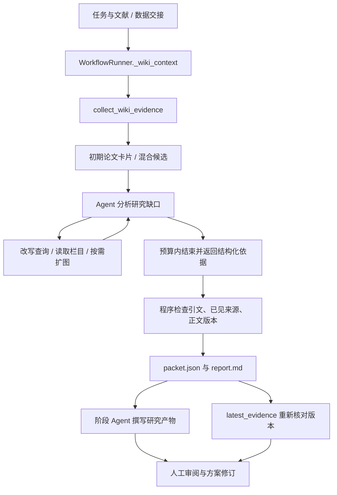

# Wiki 检索技术说明

本模块把当前 Wiki 中的论文内容转为研究 Agent 可使用的依据。Markdown 正文、来源文件和关系文件是持久知识；检索排名、向量缓存和取证包分别承担候选定位、编码复用和任务交接职责。

操作入口见 [检索使用说明](../guides/wiki-retrieval.md)。论文解析、清洗和入库核验见 [Wiki 模块说明](../wiki.md#论文预处理与证据核验)。

## 调用链与阶段职责



| 阶段 | 入口 | 输入与行为 |
| --- | --- | --- |
| 文献研究 | `_run_literature → _research_context → _wiki_context` | 初始提供最多五张论文卡片，Agent 再决定补查；原有在线论文搜索与本地 PDF 筛查继续提供其他上下文 |
| 创意生成 | `_run_ideas → _wiki_context` | 使用任务和已有数据、文献报告，优先检索方法候选 |
| 研究精炼 | `_run_refine → _research_context → _wiki_context` | 根据当前想法补充依据；保留原有本地资源读取 |
| 画布方案修订 | `api/proposal_revision.run_revision → latest_evidence` | 读取最近取证包，复查当前正文版本，交给无搜索工具的修订请求 |
| 实验规划 | 原有批准版本校验 | 使用人工批准的最终方案与冻结副本 |

`_wiki_context` 对研究阶段调用统一取证流程；非研究用途保留原有低成本预读兼容路径。阶段工具白名单允许直接使用 Wiki 工具，正常工作流则通过上述入口组织取证。

## 模块分工

| 文件 | 职责 |
| --- | --- |
| `paper_agent/tools/wiki_retrieval.py` | 读取活动页面、章节切分、中英文分词、BM25、论文卡片和来源归并 |
| `paper_agent/tools/wiki_hybrid.py` | 章节窗口、精确标识定位、本地语义编码、RRF 融合、关系导航 |
| `paper_agent/tools/wiki.py` | 对 Agent 暴露统一搜索、浏览、读取工具，附带质量和来源信息 |
| `paper_agent/agent/wiki_research.py` | 取证循环、工具预算、已见材料账本、引文校验、依据包、历史包加载 |
| `paper_agent/agent/model_client.py` | 当前取证上下文的请求次数和输出预算 |
| `paper_agent/agent/workflow.py` | 在研究节点发起取证，把结果交给产物撰写阶段 |
| `paper_agent/agent/loop.py` | 交接后关闭该次撰写的重复 Wiki 工具入口 |
| `paper_agent/api/proposal_revision.py` | 将经过版本检查的历史依据交给画布修订 Agent |

## 知识存储与检索单元

检索读取 `papers/`、`ideas/`、`experiments/`、`claims/` 的直接 Markdown 子文件，排除库外符号链接、日志、归档和重复索引。Paper 是论文事实的引用来源；本次科研取证将搜索范围固定为 `papers`，Idea、Experiment 与图用于导航。

页面按二级标题形成栏目，例如 Method、Experiments、Limitations / Failure Modes。栏目内的三级标题留在所属栏目中。系统保留页面相对路径、栏目名、行号和全文 SHA256。

语义召回在栏目内生成 400 字符窗口，步长 340，保存窗口与原文的偏移。窗口用于快速定位，Agent 可继续按完整栏目读取条件和限制。空模板及自动 Connections 占位内容不参与对应窗口召回。

不指定 `entity_type` 的通用搜索，会沿 `inspired_by` 和 `tested_by` 将派生页面归并到来源论文；来源关系损坏时保留警告与可读取的独立页面。

## 候选怎样产生

### 精确标识定位

匹配完整标题、slug、DOI 或标题冒号前的方法名。精确命中时跳过语义编码，直接定位到对应页面的栏目窗口。

### 词法与语义通道

BM25 使用英文单词、数字和中文相邻双字，参数为 `k1=1.2, b=0.75`。词频、词的稀有程度和内容长度共同影响排名。

语义通道使用固定版本的 `intfloat/multilingual-e5-small` 量化 ONNX，查询前加 `query: `，正文前加 `passage: `，采用 masked mean pooling 和 L2 归一化。编码窗口达到 512 token 饱和阈值时返回错误，避免静默截断。

两个通道各保留最多 40 个窗口，按倒数排名融合：

```text
一个窗口的融合得分 = Σ 1 / (60 + 该窗口在某通道中的排名)
```

这叫 RRF：它合并各通道的排名，不要求把 BM25 分数和向量相似度换算成相同尺度。结果再按来源论文聚合，每篇最多展示三个不同栏目的命中，避免重叠窗口占满阅读预算。

当前没有额外的交叉编码重排服务。RRF 决定先看哪些候选，Agent 负责阅读后判断用途。

### 图关系扩展

`expand_wiki_relations` 读取 `graph/edges.jsonl`，返回已有关系的端点、方向、行号、图指纹、理由和证据。Paper 可通过自身 Idea 找到一条科研关系，再定位邻居对应论文。

接口支持 `cites`、`addresses_same_problem`、`shares_method`、`may_apply_to`、`inspired_by`、`tested_by`、`contradicts`。只读取库中实际存在的边；`may_apply_to` 保留未验证标记，`tested_by` 保留论文实验方向的来源语义。单条坏边跳过并警告。

取证 Agent 根据缺口决定是否扩图。图无邻接时仍可继续文本检索；关系指向的论文需要读取后才能成为证据。

## 工具接口

### `search_wiki`

```json
{
  "query": "无需历史循环记录的电池退化预测",
  "entity_type": "papers",
  "limit": 5,
  "strategy": "auto",
  "purpose": "method"
}
```

| 参数 | 行为 |
| --- | --- |
| `strategy=auto` | 已配置语义运行环境时融合两个通道；未配置时使用 BM25；语义执行失败则返回 BM25 并明确降级 |
| `strategy=lexical` | 显式使用页面 BM25 |
| `strategy=hybrid` | 显式要求混合检索，语义执行失败返回错误 |
| `purpose=overview` | 返回最多八张当前论文卡片，按 `next_offset` 继续浏览 |
| `purpose=method/evidence/paper` | 当前都走候选检索，保留用途字段供流程解释 |

通用接口保留 `matches`、`path`、`wiki_path`、`hits`、`ranking`、`semantic_status`、`candidate_only` 等字段。混合结果的 `count` 是返回候选数；词法结果的 `count` 是切片前匹配数，调用方应按 `matches` 长度判断本批材料数量。

自动降级通过 `degraded=true`、`semantic_status=unavailable` 和 `warnings` 表达。未配置语义环境则为 `not_configured`，精确定位跳过语义时为 `skipped_exact`。

### `browse_wiki`

`browse_wiki(offset=0, limit=20)` 返回论文卡片和 `next_offset`。卡片直接摘录当前正文的 thesis、problem、method、results、limitations，每栏目最多 1000 字符，并标记缺项和截断。浏览本身不调用生成模型。

### `read_wiki`

```json
{
  "path": "papers/example.md",
  "section": "Limitations / Failure Modes",
  "offset": 0,
  "limit": 100,
  "expected_content_sha256": "从此前搜索或读取结果取得的指纹"
}
```

`section` 使用准确栏目名；不存在时返回可用栏目。指定栏目后 `offset` 相对该栏目，从零开始；返回的 `start_line/end_line` 从一开始。不指定栏目则按全页分页。搜索返回的 `read_offset` 是整页偏移，应在不传 `section` 时使用。

指纹与当前正文不符时返回 `WIKI_CONTENT_CHANGED`，要求重新取证。读取结果同时携带目录、正文版本、来源记录和质量记录。

### `expand_wiki_relations`

```json
{"path":"papers/example.md","relation":"all","direction":"both","limit":5}
```

先查看 `all` 及起点可用关系，再按实际类型理解邻接。默认最多六个邻接，接口硬上限十个；取证子流程进一步限制为五个。

## Agent 如何选择材料与结束

`collect_wiki_evidence` 将任务前 8000 字符，以及已有 `DATA_REPORT.md`、`RESEARCH_REPORT.md` 各前 8000 字符交给模型；截断会显式标注。初始候选根据阶段选择卡片或方法搜索。

Agent 可以改写查询、补读栏目、浏览下一批卡片或扩展关系。它按需要选择以下证据角色：

| `role` | 用途 |
| --- | --- |
| `direct_method` | 接近任务条件的直接方法 |
| `mechanism` | 可借鉴的局部机制 |
| `baseline` | 需要纳入评估的基线 |
| `constraint` | 输入要求、适用条件和限制 |
| `counterevidence` | 会挑战拟议主张的证据 |

不要求凑齐全部角色。最终输出 `summary`、`assessment`、`evidence`、`decisions`、`hypotheses`、`gaps` 和 `next_action`。候选决策使用 `use/adapt/exclude` 并附具体理由。

### 执行预算

| 资源 | 每次取证上限 | 执行位置 |
| --- | --- | --- |
| 模型请求 | 3 次，最后一轮不提供工具 | 取证循环及模型请求适配器 |
| Wiki 工具执行 | 6 次，含初始候选 | 工具执行入口 |
| 图扩展 | 1 次 | 关系工具调用入口 |
| 单次模型输出 | 4000 token，或配置的更小值 | 模型请求适配器 |
| 单次工具材料 | 12000 个 JSON 字符 | 交付压缩 |
| 累计工具材料 | 36000 个 JSON 字符 | 交付压缩与剩余额度 |

模型预算通过 `ContextVar` 绑定当前执行上下文。进入取证时建立预算，退出时恢复原上下文；不同任务不会争用一个全局变量。限定范围内关闭网络、格式和截断自动重试，失败尝试仍记入轨迹。

工具结果通过减少候选数、缩短可读正文来控制长度，保留完整 JSON 结构和截断标记。过大的结果会明确返回预算错误。只有真正交付给模型的正文才写入“已见材料”账本。

取证后，`evidence_handoff` 使该次报告撰写的 Wiki 工具从 schema 和执行映射中移除，避免重复开启搜索。报告撰写仍有原阶段的文件及其他工具；3 次请求只限制取证子流程。

## 引用核验与任务交接

`validate_packet` 对每条引文执行以下检查：

1. 路径属于当前 Wiki 的 `papers/`，来源文件可读。
2. 研究陈述非空，证据角色有效，逐字摘录最多 180 字符。
3. 摘录存在于指定论文的指定栏目。
4. 相同路径、相同栏目中的这段文字确实交付给本轮模型。
5. 已见材料的正文指纹与当前正文一致。

通过后补充行号、正文指纹及 `verification=quotation_and_seen_version_only`。检查不通过的摘录撤下，原因写入 `validation_errors` 和 `gaps`。已知角色同义值仅做确定性归一，并以 `role_normalized_from` 保留原值；未知角色仍拒绝。

`packet.json` 使用 `schema_version=wiki-research-v1`，包含上述结论、有效证据、候选决策、假设、缺口、关系、警告、预算、耗时与产物目录。`summary_verification` 明确表示摘要是模型解释；引文检查负责文本、来源与版本一致性。来源与质量信息随证据保留，缺失时用对应状态表达。

每次取证单独建立目录，保存原始回答、对话、工具参数、模型用量、实际已见段落和进度事件。失败也会保存已经取得的材料及错误，后续可检查具体缺口。

### 来源变化与方案修订

搜索和读取返回 `content_sha256`。取证内部为后续读取自动携带已见指纹，最终输出时再核对一次当前文件。

画布修订通过 `latest_evidence` 加载项目最近的依据包，使用当前配置的 Wiki 重新校验引用，不信任历史 JSON 内保存的任意根目录。正文更新后将包标为 `stale`，移除失效证据、旧摘要及采用建议。来源未变但用户改变了任务条件时，修订 Agent 仍须重新判断适用性；新增支持缺口写进待决事项。

SHA256 用于判断内容是否改变，不提供历史版本恢复。一次读取也不是跨多个文件的事务快照；程序在读取与交接处复查版本，仍需保持 Wiki 的正常发布和备份管理。

## 部署语义运行环境

Wiki 工具使用项目主 Python 环境。语义编码通过独立 Python 子进程运行，需要该环境已有 `onnxruntime`、`tokenizers` 和 `numpy`；下载脚本还需要 `huggingface_hub`。

从源码仓库根目录准备固定模型：

```bash
<embedding-python> scripts/setup_wiki_embedding.py \
  --destination /data/wiki-embedding-runtime \
  --python /path/to/embedding-python
```

脚本固定 E5 revision `614241f622f53c4eeff9890bdc4f31cfecc418b3`，保存 `model.onnx`、`tokenizer.json`、`identity.json`。传入 `--python` 时另写 `runtime.env`：

```dotenv
PAPER_AGENT_EMBEDDING_DIR=/data/wiki-embedding-runtime
PAPER_AGENT_EMBEDDING_PYTHON=/path/to/embedding-python
```

启动 API 或独立工作流进程前加载这两个环境变量。Docker 可通过 `--env-file` 传入，模型目录须挂载到容器内对应位置。已有 API 需要重启，之后新启动的研究 worker 会继承环境。

Wiki 根目录由 `PAPER_AGENT_WIKI_ROOT` 配置。可选 `PAPER_AGENT_EMBEDDING_CACHE` 指定向量缓存目录，默认在模型目录的 `vectors/` 下。配置路径应属于持久数据盘，编码临时文件也写入此缓存目录。

当前编码 worker 位于源码仓库的 `scripts/wiki_embedding_worker.py`；运行混合检索需要保留这份脚本及源码目录结构，单独 wheel 不包含该脚本。

### 缓存与内容更新

缓存键包含实际模型/tokenizer 文件哈希、模型身份和完整带前缀文本。正文更新后，新文本自动使用新缓存键；模型文件替换后，旧向量也不会被当作新模型输出。Wiki 每次按当前正文读取，不另维护一份摘要索引。

缓存写入采用同目录临时文件替换；缓存可删除重建。当前未自动清理旧键，也没有常驻编码服务。每次请求会扫描当前页面、检查缓存并按需启动子进程，后续维护应根据库规模观察这些步骤的耗时。

## 排错与验证

| 情况 | 检查位置与处理 |
| --- | --- |
| 自动降为关键词检索 | 查看 `warnings/semantic_status`，核对模型目录、Python 路径、依赖及模型文件 |
| `WIKI_CONTENT_CHANGED` | 重新搜索或读取当前版本，再生成依据 |
| 引文被撤下 | 查看 `validation_errors` 与 `observed-passages.json`，区分未读、错栏目、摘录不符和版本变化 |
| 图无结果 | 检查起点可用关系及 `graph/edges.jsonl`；继续文本检索 |
| 请求失败或材料预算用尽 | 查看 `model-calls.json`、`tool-calls.json` 和 `events.jsonl`，依据缺口决定补充范围 |
| 画布修订没有历史依据 | 正常完成一次研究节点取证，再进行方案修订 |

运行确定性测试：

```bash
python -m pytest tests/test_wiki_research.py tests/test_wiki_hybrid.py \
  tests/test_wiki_tools.py tests/test_model_retry.py -q \
  --basetemp=<test-output-parent>/wiki-retrieval
```

测试临时目录的父目录需已存在。测试覆盖预算、引文来源、正文更新、无答案、孤立图、语义降级，以及同一 Agent 取证后转入报告撰写的交接。

固定验收使用 `scripts/accept_wiki_retrieval.py`：

```bash
python scripts/accept_wiki_retrieval.py \
  --wiki-root <wiki-dir> \
  --projects-root <snapshot-projects-dir> \
  --output <fresh-output-dir>
```

默认读取 `tests/fixtures/wiki_retrieval_queries_v1.json` 的16条查询，并验证四项合成工程边界。`--live` 会读取脚本指定的两个真实项目，在独立副本中仅运行正式取证入口；这会使用当前模型连接。`--repair-offline` 用于重新检查已有响应和边界测试，不调用模型，与 `--live` 互斥。测试输出、模型缓存、实际项目数据和凭据留在运行目录，不提交 Git。

## 设计依据

- [BM25](https://nlp.stanford.edu/IR-book/html/htmledition/okapi-bm25-a-non-binary-model-1.html)：以词频、稀有词和长度组织词法排名。
- [Multilingual E5 Small](https://huggingface.co/intfloat/multilingual-e5-small)：本地多语言编码模型及查询/正文前缀约定。
- [Reciprocal Rank Fusion](https://doi.org/10.1145/1571941.1572114)：以排名融合候选列表。

围绕论文场景，系统将栏目、来源、条件和限制保留到后续读取与交接；关系导航服务发现，证据包服务当前研究决策，人工审阅负责最终方案选择。
